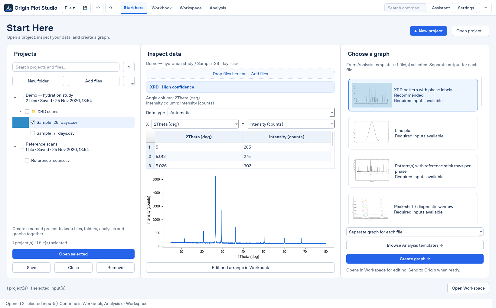

# Origin Plot Studio 5.57 / 5.58 — the project workbench, merged into the app

5.57.0 is the app you had at 5.56.0 with the three-column **Start here** (Projects → Inspect data → Choose a graph), a
**Workbook** section and a lighter header from the project-workbench update. The update was written against 5.55.7 and
was merged, not copied over: everything the app did before is still there, and what the update had dropped was put back
(see "What was put back" below).

## Get it

* **An installed app:** Help ▸ *Check for updates and install*, once this version is on the `main` branch. The app
  redraws its example files with the new version before installing; this version draws all of them exactly as 5.56.0
  did.
* **From the repository:** download it, open `origin_plot_app`, run `Setup.bat` (it keeps your settings and projects).
  `Run_Origin_Plot_App.bat` runs the copy without installing. `origin_plot_app/requirements.txt` lists the Python
  packages.

## Start here

* **A file without a project.** Add or drop a file and it is read, shown and offered its graphs. No project is asked
  for. It is listed on the left under **Files not in a project**; drag it onto a project to make it part of one.
* **A whole folder.** *Add folder…* (or drop a folder on the page) brings in every data file in it, its sub-folders too,
  shown as folders the way they are on the disk. It goes into the selected project; with none selected, a project named
  after the folder is made.
* **Projects.** *New project* names one; add files to it, make folders (••• ▸ *New empty folder…*), move files into them, rename and reorder from the
  ••• menu or the right-click menu. Removing anything from a project never deletes a file on the disk.
* **Tick, then open.** Click a project, folder or file to tick it; click again to untick (the small box works too). The line under the tree says what is ticked, and the highlighted file is the one shown in Inspect data. **Open selected**
  reads them and **shows them in Workspace** when they are read. **Open Workspace** does the same for what is ticked,
  and just opens Workspace when nothing is.
* **Save / Close / Export.** *Save* keeps data edits, column choices and graph settings in the project. *Close* saves and
  takes the project's graphs out of Workspace. *Export project…* writes a portable `.opsproject` with copies of the
  input files; *Open project…* imports one as a project of its own.
* **Missing files** are marked in the tree; ↻ rechecks the disk.

## Inspect data and choose a graph

The middle column shows the file you click: what kind of measurement it looks like and **why** (the columns it was
recognised by), its first rows, and a plot of the X and Y columns you choose. **Data type** confirms or corrects the
kind; every class of the template catalogue can be chosen there.

A file is recognised from its contents — column names and units, never the file extension:

* `2θ`, `2Theta`, `2-theta`, `Two theta`, `Pos. [°2Th.]` … with an intensity column: an **XRD scan**.
* The same with a calculated column (`Icalc`, `Ycalc`, `Calculated` …): a **pattern and fit**. Its curves are taken by
  their column names, so an export with a leading `No.` column or a background column is drawn correctly.
* Positions with widths, areas or h k l: a **peak list**, not a scan — scan templates are not offered for it.
* Numbers only, with an angle-like range: *tentative*; nothing specialised is offered until you confirm it. A plain
  **Line plot** of the mapped columns is always available.

**Choose a graph** lists the templates of Analysis that fit the file you are looking at — the same catalogue, your own
templates included — each with its picture and the reason it fits or what is missing. With several files ticked, a
graph is made for each ticked file the template fits; the others are named and left out. **Create graph** opens the result in Workspace.

**Samples that belong together (5.58).** When the ticked files are the same kind of measurement and their names are
built the same way (`10-900-AB`, `10-950-AB`, `20-900-AB`; `Ref_rep1`, `Ref_rep2`; `S1`, `S2`), the app takes them
for one series: *Combine selected files in one graph* is chosen for you, the graphs that show several samples come
first (the stacked one before the others), and the line above the list says why. A ticked file of another kind is left
out of that graph and named. *Separate graph for each file* is one click away and is kept for those files. Files that
are not a series are never combined by the app.

## Workbook

Edit working copies (the source files are never written), choose the sheet, order and switch columns, set X and Y, set
the data type, arrange the files, export the prepared data. Two merges make a new, separate dataset:

* **Append rows** needs the same columns in every file and records the source file of each row.
* **Join columns** needs identical X values in the same order. Nothing is interpolated, averaged or dropped silently.

A choice of columns is remembered for other files with the same headers, as before, unless that file has its own.

New in 5.58:

* **Side by side** is a third way to merge, and the first choice: for every file its X column and its Y columns next to
  each other, named `column [file]`; every file keeps its own X values. For a series of files the app makes this table
  by itself - it is the last entry of *Selected files* - and *Export data…* saves it. *Merge selected files…* adds such
  a table as a dataset of its own (no project is needed); Workspace reads it back as one graph per sample.
* **DTG by itself.** The working copy of a thermal run has a column `DTG (%/°C)`; it is exported with the data and is
  used in graphs only if you tick it under Columns.
* **A column left out in all files.** Untick a column and press *Use these column choices for all files*, or right
  click a column ▸ *Leave out in all files*. It is not carried to Workspace and no longer counts for the graphs offered.
* **Peaks — found by the app.** The last sheet of a thermal run or an infrared spectrum: every step of mass loss or
  band, what it **may be** (the usual event or bond at that position; a possibility to check, not a finding), the other
  possibilities, and a **Label** of your own. *Draw these labels on the graph* writes them on the TGA / FTIR graphs of
  that file; off, the graphs are as before. Excel export puts the peaks on a second sheet.
* A thermal run exported as temperature, time, mass, DSC is shown as **mass against temperature** (X and Y by what the
  columns are, until you choose them).

## Graph controls

*Edit this graph…* in Workspace (or *Edit components / panel zoom…* on an Analysis preview) changes one graph, or one
panel of it: markers on measured and fitted curves separately, the zoom inset and its range, the difference row, the
Bragg rows, a background curve. A control is greyed out, with the reason, where the graph has no such component — the app
does not invent reflections or a background. *Apply … to all graphs in this project* is a separate, explicit tick.

Composed figures and pattern-and-fit Sample pages keep their per-panel controls (the Panel bar, and *Edit each graph /
panel independently*). `docs/GRAPH_OPERATIONS_AUDIT.md` records, for each of the 122 templates and 26 workbook graph
types, which controls apply and that they work.

## What was put back

The update had lost these; 5.57.0 has them again:

* **View**, **Tools** and **Help** as buttons on the header (on a narrow window they are in the ••• menu).
* Adding a file without having to create a project.
* A column choice remembered for files with the same headers.
* The sheet of a workbook that fits the ticked template is picked by itself.
* A file that cannot be read is listed and says why in plain words.
* A tooltip on every button.
* The header's "Add files…" and "Update available" buttons had been left outside the header's layout and appeared as a
  block over the top-left corner.

## The window no longer stops while files are read

Adding ten files used to stop the window for several seconds (each file re-ranked all templates, and each ranking rebuilt
every template's example). It is now about half a second; the files are read in the background and the page shows a
file as soon as it is read. A workbook with dozens of sheets still takes its time to read (about a minute for a 3 MB,
50-sheet one), but the window stays usable meanwhile.

## PowerPoint and Word (5.57.2)

*Export ▸ Send to PowerPoint* puts the graph on show on a slide as a picture; *Send to Word* puts it into a document as
a 600 dpi picture at its printed size. With two or more graphs ticked, each gets its own slide or picture. The file is
written to the results folder and opened.

## Send to Origin

*Draw in Origin* / *Send to Origin* use the same driver, with the same report of what differs. Since 5.57.2 the figures
of a workbook and "Draw in Origin like this" are sent so that Origin shows them as the app does (texts, legends, sizes,
column widths, tick steps - see `CHANGELOG.md`). Saving a
project, exporting a figure and sending to Origin are three separate commands.

**Not verified here:** Windows itself and a live Origin. Everything was run with PySide6 on Linux without a screen;
Origin was the driver's dry run (it writes the commands and worksheets). See `VALIDATION_RESULTS.md`.
